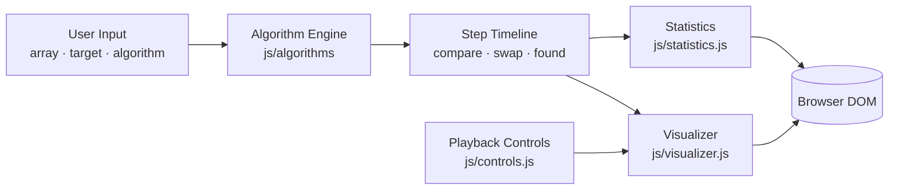

<div align="center">

# ⚡ AlgoVision

### Interactive DSA Visualizer

**Understand Algorithms. Visualize Every Step. Master DSA.**

An interactive, frontend-only learning platform that makes Data Structures and Algorithms easier to understand through visual execution, code walkthroughs, and complexity analysis.

<br />

[](https://front-kf6gxgcah-khaleelxrahmans-projects.vercel.app)

<br />


</div>

---

## 📑 Table of Contents

- [Overview](#-overview)
- [Highlights](#-highlights)
- [Algorithms in Scope](#-algorithms-in-scope)
- [Architecture](#-architecture)
- [Technology Stack](#-technology-stack)
- [Getting Started](#-getting-started)
- [Project Structure](#-project-structure)
- [User Workflow](#-user-workflow)
- [Team & Responsibilities](#-team--responsibilities)
- [Roadmap](#-roadmap)
- [Quality & Testing](#-quality--testing)
- [Contributing](#-contributing)
- [FAQ](#-faq)
- [License](#-license)

---

## 🚀 Overview

**AlgoVision** is a browser-based educational platform that turns abstract algorithm logic into something you can *see*. Instead of reading code and guessing how it behaves, learners watch data change operation by operation, follow the logic alongside readable source code, and build real intuition for time and space complexity.

Built with **HTML, CSS, and vanilla JavaScript**, it runs entirely in the browser: no backend, no database, no build step.

### 🎯 Objectives

| | Goal |
|---|---|
| 👁️ | Make DSA concepts easier to grasp through visual learning |
| 🪜 | Demonstrate algorithm execution one step at a time |
| 🔗 | Connect algorithm logic with readable source code |
| 📈 | Explain time and space complexity in an accessible way |
| 📱 | Deliver a responsive experience across desktop, tablet, and mobile |
| ⚙️ | Keep the implementation simple to run, demo, and extend |

---

## ✨ Highlights

| Feature | Description |
|---|---|
| 🎬 **Interactive Visualization** | Watch elements move, compare, and swap during execution |
| 🧭 **Algorithm Selection** | Pick from a curated collection of sorting and searching algorithms |
| ✍️ **Custom Input** | Experiment with your own arrays and search targets |
| 👣 **Step-by-Step Execution** | Advance through operations one step at a time |
| ⏯️ **Playback Controls** | Play, pause, step forward, and reset |
| 💻 **Code Walkthrough** | Follow the source code that matches each step |
| 🧮 **Complexity Analysis** | Study time and auxiliary-space complexity for every algorithm |
| 📊 **Operation Statistics** | Track comparisons, swaps, and other operations where supported |
| 📱 **Responsive Interface** | Adapts to desktop, tablet, and mobile screens |
| 🔒 **Client-Side Only** | No server, no sign-up, no data leaves the browser |

> **Note:** This table describes the intended project scope. Implementation status is tracked in the [Roadmap](#-roadmap).

---

## 🧮 Algorithms in Scope

### Sorting

| Algorithm | Best | Average | Worst | Space | Stable |
|---|:---:|:---:|:---:|:---:|:---:|
| **Bubble Sort** | O(n) | O(n²) | O(n²) | O(1) | ✅ |
| **Selection Sort** | O(n²) | O(n²) | O(n²) | O(1) | ❌ |
| **Insertion Sort** | O(n) | O(n²) | O(n²) | O(1) | ✅ |
| **Merge Sort** | O(n log n) | O(n log n) | O(n log n) | O(n) | ✅ |
| **Quick Sort** | O(n log n) | O(n log n) | O(n²) | O(log n)† | ❌ |

### Searching

| Algorithm | Best | Average | Worst | Space | Requires Sorted Input |
|---|:---:|:---:|:---:|:---:|:---:|
| **Linear Search** | O(1) | O(n) | O(n) | O(1) | ❌ |
| **Binary Search** | O(1) | O(log n) | O(log n) | O(1)‡ | ✅ |
| **Jump Search** | O(1) | O(√n) | O(√n) | O(1) | ✅ |
| **Interpolation Search** | O(1) | O(log log n)* | O(n) | O(1) | ✅ |
| **Exponential Search** | O(1) | O(log n) | O(log n) | O(1)‡ | ✅ |

<sub>
† Quick Sort space reflects average recursion-stack depth.<br />
‡ Assumes an iterative implementation; a recursive version uses O(log n) stack space.<br />
* Interpolation Search's average case assumes sorted, suitably (near-uniformly) distributed data.
</sub>

---

## 🏗️ Architecture

AlgoVision separates **algorithm logic** from **rendering**: each algorithm produces an ordered list of steps, and the visualizer simply plays those steps back. This keeps the UI simple and makes new algorithms easy to add.



**Design principles**

- **Pure algorithm functions.** Each algorithm records steps instead of touching the DOM.
- **Deterministic playback.** The same input always produces the same timeline, so stepping backward and resetting are reliable.
- **Zero dependencies.** Nothing to install, nothing to break.

---

## 🛠️ Technology Stack

| Technology | Purpose |
|---|---|
| **HTML5** | Semantic page structure and content |
| **CSS3** | Layout, styling, transitions, and responsive design |
| **Vanilla JavaScript** | Algorithm execution, visualization state, and controls |
| **Git & GitHub** | Version control and team collaboration |
| **Vercel** | Static hosting and continuous deployment |

No Python runtime, API server, database, or backend service is required.

---

## 🖥️ Getting Started

### Prerequisites

- A modern web browser (Chrome, Edge, Firefox, or Safari)
- [Git](https://git-scm.com/) *(optional, for cloning)*
- A code editor such as [Visual Studio Code](https://code.visualstudio.com/)

### Run Locally

```bash
# 1. Clone the repository
git clone https://github.com/YOUR_USERNAME/AlgoVision.git
cd AlgoVision

# 2. Open index.html in your browser
#    or serve it with any static server, for example:
npx serve .
```

> Replace `YOUR_USERNAME` with the GitHub account that owns the repository.

With VS Code, you can also right-click `index.html` and choose **Open with Live Server** for automatic reloads.

No dependency installation is needed unless additional libraries are introduced later.

---

## 📁 Project Structure

```text
AlgoVision/
├── index.html
├── README.md
├── assets/
│   ├── icons/
│   └── images/
├── css/
│   ├── style.css
│   ├── layout.css
│   └── responsive.css
├── js/
│   ├── app.js
│   ├── algorithms/
│   │   ├── sorting.js
│   │   └── searching.js
│   ├── visualizer.js
│   ├── controls.js
│   └── statistics.js
└── docs/
    └── screenshots/
```

*This is a suggested structure. Adjust the paths to match the actual repository files.*

---

## 🎮 User Workflow

```text
 ① Open AlgoVision  →  ② Choose an algorithm  →  ③ Enter or generate data
          ↓
 ④ Start execution  →  ⑤ Watch each operation  →  ⑥ Step / pause / replay
          ↓
 ⑦ Review code & complexity  →  ⑧ Reset and experiment again
```

---

## 👥 Team & Responsibilities

| Member | Role | Responsibility |
|---|---|---|
| **Member 1** | Frontend & Design | Interface, visual design, responsive layout, and controls |
| **Member 2** | Algorithms & Logic | Algorithm execution, visualization steps, and operation statistics |
| **Member 3** | Content & Learning | Python algorithm examples, code explanations, and learning content |

> **Architecture note:** Member 3's Python implementations can serve as educational reference examples. A browser-only application cannot execute Python without an extra runtime or backend, so the interactive visualizer itself uses JavaScript implementations.

### Collaboration Guidelines

- Work on separate branches for individual features
- Use clear, descriptive commit messages
- Open pull requests before merging substantial changes
- Test each feature before integration
- Agree on shared interfaces and data formats before implementing

---

## 🗺️ Roadmap

| Phase | Milestone | Status |
|:---:|---|:---:|
| 1 | Responsive application layout | ⬜ |
| 2 | Algorithm selection interface | ⬜ |
| 3 | Sorting visualizations | ⬜ |
| 4 | Searching visualizations | ⬜ |
| 5 | Step-by-step playback controls | ⬜ |
| 6 | Code highlighting linked to operations | ⬜ |
| 7 | Operation counts and complexity panel | ⬜ |
| 8 | Input validation and edge-case handling | ⬜ |
| 9 | Testing across input sizes | ⬜ |
| 10 | Screenshots and published live demo | 🟨 Demo deployed |

*Legend: ⬜ Planned · 🟨 In progress · ✅ Complete. Update as features are implemented and verified.*

### 🌱 Future Enhancements

- Side-by-side algorithm comparison
- Adjustable animation speed
- Additional algorithms and data structures (trees, graphs, heaps)
- Interactive quizzes and learning challenges
- Accessibility improvements and full keyboard navigation

*These are possible extensions, not claims about currently implemented features.*

---

## 🧪 Quality & Testing

**Correctness**

- [ ] Sorting algorithms produce correctly ordered output
- [ ] Searching algorithms return the correct index or "not found"
- [ ] Binary-based searches validate sorted input
- [ ] Statistics stay consistent with executed operations

**Edge cases**

- [ ] Empty input is handled safely
- [ ] Single-element arrays work
- [ ] Duplicate and negative values work where applicable

**Interaction & UI**

- [ ] Pause, resume, reset, and step controls behave correctly
- [ ] Layout remains usable on small screens
- [ ] Browser console shows no unexpected errors

---

## 🤝 Contributing

Contributions from the project team are welcome.

1. **Clone** the repository
2. **Branch** from `main` with a focused name, such as `feature/merge-sort-visualizer`
3. **Implement** one clearly scoped feature
4. **Test** locally against the checklist above
5. **Commit** with a descriptive message, such as `feat: add merge sort step recording`
6. **Push** your branch and **open a pull request** for review

Keep changes focused and coordinate before modifying another member's work.

---

## ❓ FAQ

<details>
<summary><b>Do I need to install anything to run AlgoVision?</b></summary>
<br />
No. Open <code>index.html</code> in a modern browser, or visit the live demo.
</details>

<details>
<summary><b>Why do some searches require sorted input?</b></summary>
<br />
Binary, Jump, Interpolation, and Exponential Search rely on order to skip elements safely. On unsorted data they can return wrong results, so AlgoVision validates input for these algorithms.
</details>

<details>
<summary><b>Can the visualizer run Python code?</b></summary>
<br />
Not in a browser-only app. The visualizer runs JavaScript implementations, while Python versions serve as educational reference examples.
</details>

---

## 📄 License

A license has not yet been specified. Add a `LICENSE` file once the project owner selects the intended license.

---

<div align="center">

**AlgoVision — Learn the Logic. See the Execution. Understand the Algorithm.**

<sub>Built as a collaborative learning project.</sub>

</div>

<!-- VERCEL_DEPLOYMENT_START -->
## Live Demo

**[🚀 Open AlgoVision](https://front-kf6gxgcah-khaleelxrahmans-projects.vercel.app)**

Deployed on Vercel.
<!-- VERCEL_DEPLOYMENT_END -->
